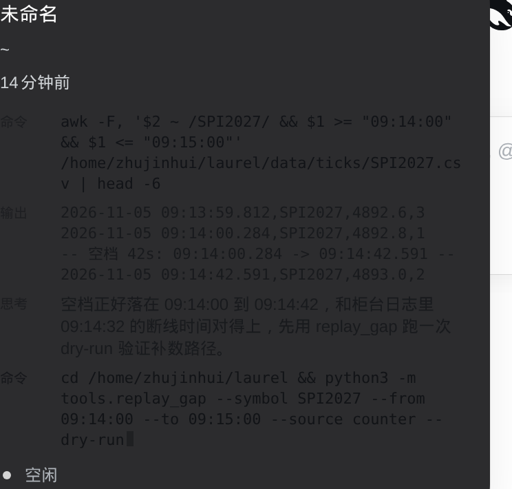
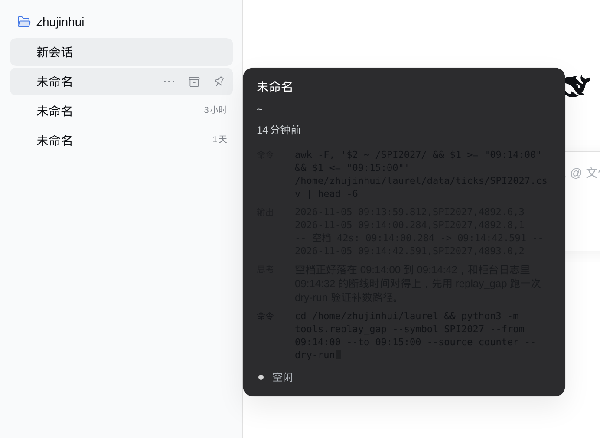

# dsh-session-progress

把鼠标悬停在 DSH 侧栏的会话行上时，卡片里除了「进行中」，再多显示**最近 4 条真实进度**：思考、执行的命令、命令输出、回复。数据来自该会话自己的事件日志，不需要打开会话。

长命令和长输出**换行显示全文**，不再省略号截断；会话还在跑时，卡片会以 600ms 的节奏自己刷新，最新一行末尾有一个闪烁光标，内容一变就淡入——看起来就像在旁边看它干活。





```
┌──────────────────────────────────────────┐
│ Level2 行情接入                            │
│ ~/laurel                                  │
│ 14分钟前                                   │
│ 命令  awk -F, '$2 ~ /SPI2027/ && $1 >=    │
│        "09:14:00" && $1 <= "09:15:00"'     │
│        …/ticks/SPI2027.csv | head -6       │
│ 输出  2026-11-05 09:13:59.812,SPI2027,…    │
│       -- 空档 42s: 09:14:00.284 -> …       │
│ 思考  空档正好落在 09:14:00 到 09:14:42，  │
│       和柜台日志里 09:14:32 的断线对得上。 │
│ 命令  cd ~/laurel && python3 -m            │
│       tools.replay_gap --symbol SPI2027 …▍ │  ← 运行中：末尾闪烁光标
│ ◌ 进行中                                   │  ← 原有的状态行，保持不变
└──────────────────────────────────────────┘
```

## 安装

```bash
# 从 npm 安装
dsh plugin --profile web add dsh-session-progress

# 从本地目录安装（开发中）
dsh plugin --profile web add /path/to/dsh-session-progress

# 从 git 安装
dsh plugin --profile web add github:huieric/dsh-session-progress
```

安装后重启 `dsh web`（loader 行在启动时读取），浏览器刷新页面即可。

卸载：

```bash
dsh plugin --profile web remove dsh-session-progress
```

## 它怎么工作

| 半个插件 | 位置 | 职责 |
| --- | --- | --- |
| Host | `lib/index.js` | 注册同源路由 `GET /dsh-session-progress/tail`，把某个会话的尾部事件压缩成几行文本 |
| Browser | `lib/client.js` | 注册 `sidebar.session.row.hover` 槽位组件，卡片打开时轮询上面的路由，卡片关闭即停止 |

数据来源优先取内存里的活会话（`ctx.sessions`），拿不到再读会话账本（`ctx.sessionPersistence`，`session.v4.jsonl.zstd`），所以**已结束的会话和刚聊过的会话都能显示**。

事件到行的映射：

| 事件 | 行 |
| --- | --- |
| `user/message` | 你 |
| `assistant/message` → `reasoning` | 思考 |
| `assistant/message` → `tool-call` / `tool/call` | 命令（优先 `command` 首行，否则 `file_path`/`path`/`query`…） |
| `tool/result` | 输出 |
| `assistant/message` → `text` | 回复 |

### 换行、宽度与刷新

- 正文用 `white-space: pre-wrap` + `overflow-wrap: anywhere`，标签列固定 34px，正文占满剩余宽度，**长命令/长输出按宽度折行**，不裁剪。
- 卡片宽度：插件用 `:has()` 让宿主的两层祖先容器长到 372px（默认 244px），给正文腾出空间；宿主以后若改了宽度，`:has()` 规则失效也只是回到默认宽度，换行照旧生效。
- 单条最多 6 行、最长 640 字符，超出才加 `…`（纯属防御，正常进度不会触到）。
- 会话「运行中」（最近 90 秒内有事件且 turn 未结束）时每 **600ms** 刷新，空闲时 **1800ms**；最新一行带闪烁光标，内容变化时淡入；系统开启「减少动态效果」时自动关闭动画。

## 安全与隐私

- 路由**不是公开的**：每个请求都要过 `connection.requestRejection(req)`，即 Web API 同一套 Host/Origin + 签名 cookie 校验（未通过回 401/403）。
- 只接受形如 `session-<uuid>` 的 id，长度 ≤ 128，字符集 `[A-Za-z0-9._-]`，不做任何路径拼接。
- 数据不出本机：浏览器从 127.0.0.1 的同源路由取数，插件不发任何外部请求。
- `~/.dsh/session-progress/status.json` 只写 `version / pid / 时间戳 / 请求计数 / 最近一次会话 id`，**不写任何会话内容**，用于排查「插件到底有没有加载」。删掉该文件不影响功能。

## 配置

| 键 | 默认 | 说明 |
| --- | --- | --- |
| `cacheMs` | `700` | 同一会话的轮询结果缓存时长（缓存键带事件计数，不会拿到旧内容） |

在 profile 的 `cordis.patch.yml` 里改：

```yaml
- id: session-progress
  config:
    cacheMs: 1500
```

## 可见性

- 会话还没有任何事件时不显示（不会占位）。
- 只显示最近 4 行；每行换行显示全文，鼠标悬停该行仍可看 `title`。
- 空会话 / 读不出来的会话静默隐藏，不显示错误。

## 开发

```bash
npm install          # 仅测试用的 react / react-dom / react-test-renderer
npm test             # node --test test/*.test.mjs
```

测试覆盖三层，且不依赖正在运行的 DSH：

1. `test/tail.test.mjs` —— 事件到行的纯函数映射（换行保留与折叠、按行/字符截断、v4 `user/message` 形状、代理对截断、畸形事件）。
2. `test/host.test.mjs` —— 鉴权短路、方法/id 校验、live/stored 两条数据源、事件计数缓存、`isRunning` 判定、`status.json` 内容，并用**本机真实会话账本**跑一遍。
3. `test/client.test.mjs` —— 用 `vm` 按浏览器方式加载 `lib/client.js`，断言 `inject`/`apply` 注册的槽位与文案、CSS 只注入一次（且不含 ellipsis、含 `:has()` 加宽）、`renderLines` 转义与光标、`createPoller` 的动态间隔与失败停止，以及用 `react-test-renderer` 真实挂载组件验证 `fetch → 渲染` 全链路。

## 兼容性

- DSH `>= 0.2.0-rc.1 < 0.3.0`
- Node `>= 20`（Host 侧没有额外依赖）

## License

MIT
